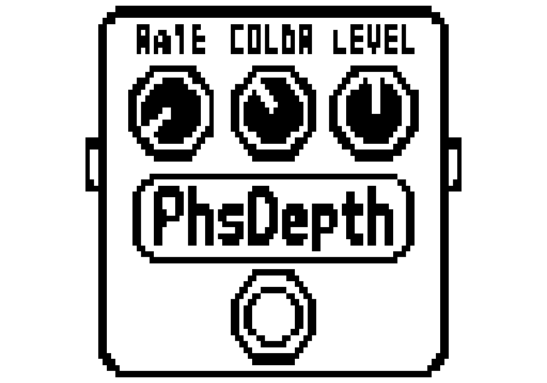

# PhsDepth — Zoom MS-70CDR original (azul), firmware 2.10

**Versão 1.11, nova capa no estilo do Phaser original:** [dist/PhsDepth.ZDL](dist/PhsDepth.ZDL), 6.478 bytes. O proprietário informou que a versão anterior 1.00 funcionou na pedaleira ([registro](docs/HARDWARE_TESTS.md)); **a versão 1.11 ainda não foi testada fisicamente**. Há testes locais e emulação do binário TI C674x.

| Controle | Valores | Função |
|---|---|---|
| Rate | 0–100 | Velocidade do LFO selecionado, 0,08–6 Hz; padrão 35 |
| Color | 0 / 1 / 2 / 3 | 4 normal / 8 normal / 4 invertido / 8 invertido |
| Level | 0–100 | Ganho de saída, 0–2×; 50 = ganho nominal unitário |
| Depth | 0–100 | Excursão logarítmica dos filtros em torno de 550 Hz, até ±3 oitavas |
| Wave | 0–6 | 0 Triangle (padrão), 1 Sine, 2 Square, 3 Saw Up, 4 Saw Down, 5 Random, 6 Step |

Depth em zero mantém um phaser estático; não mistura seco/molhado. A soma é sempre 50% seco + 50% sinal dos filtros (polaridade definida por Color), multiplicada por Level. Os canais L/R têm memória independente. Rate, Color e Level ficam na primeira página; Depth e Wave na segunda. Color e Wave são mostrados numericamente. [Detalhes e diferenças em relação ao Boss PH-3](docs/WAVE.md).

Identidade: categoria Modulation (`gid 6`), `fxid 947`, índice **`0x060003B3`**. Não reutiliza o ID de um Phaser original. A [auditoria](docs/id-audit.json) de 11/11/2026 consultou 581 arquivos de sete coleções públicas, incluindo efeitos Zoom, manifests e bancos de IDs. Não encontrou esse fxid em nenhum grupo nas fontes consultadas. Não existe reserva global de IDs; a lista de efeitos realmente instalados também deve ser conferida.

## Imagem no pedal

Capa monocromática 128×64 no estilo da foto da MS-70CDR original fornecida pelo proprietário: pedal grande, três knobs octogonais no topo com Rate/Color/Level, placa PhsDepth no centro e footswitch embaixo. As posições dos valores do firmware foram alinhadas aos knobs no topo. Depth e Wave continuam na segunda página.



A prévia acima usa a proporção aproximada dos pixels do LCD original (altura/largura 1,4); a [prévia com pixels quadrados](dist/PhsDepth-cover.png) e o [bitmap 128×64](dist/PhsDepth-cover.pbm) também estão incluídos. Não é fotografia nem confirmação física da nova interface.

A arte gerada a partir da referência está fixada em `zoom/art/stock-style.pbm`; `zoom/cover.py` a codifica para o ZDL e compartilha as posições dos knobs com o linker. A geração da imagem não é uma dependência do build. O objeto C674x do DSP é idêntico byte a byte ao da versão 1.10; esta alteração modifica a arte, suas coordenadas e a versão para 1.11.

## Validação concluída

- Compilação com **TI C6000 CGT 8.5.0.LTS**, C674x, EABI, dados `far`; sem símbolos DSP externos, heap, BSS ou globais graváveis no DSP.
- Linker de [repeat98/ZoomMultistompZDL](https://github.com/repeat98/ZoomMultistompZDL), fixado em `32f3d6877d892409c6defeeeec57040ad004d31f`. Runtime próprio (`own_runtime`) com handlers para os cinco controles e inicialização dos valores salvos; dispensa blobs extraídos de efeitos Zoom.
- Invariantes de áudio, limites dos buffers, bypass, instâncias independentes, controles inválidos, comparação host/wrapper, AddressSanitizer e UndefinedBehaviorSanitizer.
- Verificação independente de ZDL/ELF, arquitetura, exports, relocations, parâmetros, ID e tamanho; testes de rejeição de arquivos corrompidos.
- **Triangle compatível com 1.00**: 20 renders comparados aos fingerprints do código anterior, áudio host idêntico bit a bit. As sete ondas também passam por oráculos de forma/frequência, limites, profundidade e edição em execução.
- **Ziddle C674x**: matriz de 252 combinações das sete ondas e quatro Color, com defaults e extremos. Inicialização, cinco handlers e áudio comparados ao DSP host. 9.175.040 amostras de canal, erro máximo 0,000001281 e nenhuma instrução não implementada. Resultados em [dist/emulator-report.json](dist/emulator-report.json).

O emulador usa callbacks de host simulados; não prova a ordem de inicialização do firmware, a paginação na tela, o roteamento estéreo real ou a ausência de travamentos na pedaleira. O custo DSP declarado (40) é uma estimativa provisória, sem medição física; ciclos do emulador não equivalem à carga real.

## Compilar e testar

Linux x86-64, Python 3.10+, compilador C, Git, curl e sha256sum:

```sh
./tools/build.sh                 # baixa TI oficial + referência fixada em work/
./tools/test.sh                  # testes C, sanitizers e artefato ZDL
python3 tools/validate_zdl.py
```

O instalador TI permanece local em `work/`; seus termos próprios se aplicam. Para usar instalações existentes:

```sh
python3 zoom/build.py --upstream /caminho/ZoomMultistompZDL \
    --ti-root /caminho/ti-cgt-c6000_8.5.0.LTS
```

Para repetir o teste do binário, extraia [Ziddle 1793487371](https://berbasoft.com/ziddle/ziddle-1793487371.zip), instale Rust/cargo e execute:

```sh
python3 tools/emulator/run.py --ziddle /caminho/ziddle-1793487371
```

Consulte [dependências e integração](docs/ZDL_INTEGRATION.md), [resultado dos testes](docs/VALIDATION.md) e [procedimento físico pendente](docs/INSTALLATION.md). Os hashes estão em [dist/SHA256SUMS](dist/SHA256SUMS). As licenças do runtime e os avisos TI acompanham o binário em [licenses/](licenses/).
