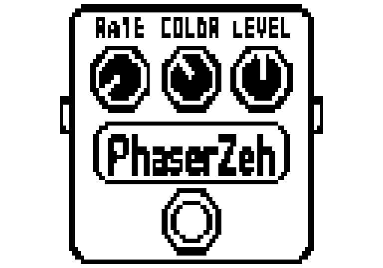

# PhaserZeh — Zoom MS-70CDR original (azul), firmware 2.10

**Versão 1.30:** [dist/PhasrZeh.ZDL](dist/PhasrZeh.ZDL). Nome na tela **PhaserZeh**; o arquivo usa **PhasrZeh** pelo limite de oito caracteres. Mantém o ID `0x060003B3` do PhsDepth: atualize somente o efeito personalizado existente, sem instalar duas versões do mesmo ID e sem substituir efeitos originais.

A 1.30 simplifica Wave, dá mais precisão ao Rate lento e acrescenta os nomes dos seletores. **Ainda não foi testada fisicamente.** Os relatos sobre as versões anteriores estão em [HARDWARE_TESTS.md](docs/HARDWARE_TESTS.md).

| Controle | Valores | Função |
|---|---|---|
| Rate | 0–100 | Curva exponencial de 0,05 a 3 Hz; padrão 35 ≈ 0,21 Hz |
| Color | 4 STG / 8 STG / inv 4 / inv 8 | Quatro/oito estágios, mistura normal/invertida |
| Level | 0–100 | Ganho 0–2×; 50 = nominal unitário |
| Depth | 0–100 | Amplitude da varredura em torno de 550 Hz, até ±3 oitavas |
| Wave | Tri / Sine / Step | Três formas: triangular, senoidal e oito posições com bordas suavizadas |

Rate/Color/Level ficam na primeira página; Depth/Wave na segunda. Color e Wave passam a mostrar **palavras**, por callbacks próprios de texto. A aparência aprovada e o nome PhaserZeh foram preservados.

## Rate com mais espaço para velocidades lentas

A curva nominal é `0,05 × 60^(Rate/100)`. Aproximadamente 73% do giro fica abaixo de 1 Hz; cada ponto inteiro altera a velocidade em cerca de 4,18%, dando ajustes graduais também na faixa lenta.

| Rate | Velocidade nominal | Período aproximado |
|---|---|---|
| 0 | 0,05 Hz | 20 s |
| 25 | 0,139 Hz | 7,19 s |
| 50 | 0,387 Hz | 2,58 s |
| 75 | 1,078 Hz | 0,93 s |
| 100 | 3 Hz | 0,33 s |

**Patches antigos ficam mais lentos com o mesmo número de Rate.** Isso é intencional; reajuste e salve a velocidade desejada. A fase não reinicia ao editar Rate. Os períodos reais podem diferir ligeiramente pelos cálculos float32 e pelo aparelho.

## Três Wave e preservação do áudio

Agora são **0 Tri, 1 Sine e 2 Step**. Square/rampas/Random foram retirados conforme combinado. Step antigo 6 corresponde ao novo 2; há tolerância no DSP para o código legado 6, mas a interface/firmware pode limitar valores ao carregar patches antigos: confira e salve Wave novamente.

A forma e o áudio das três ondas permanecem bit a bit iguais às referências host **na mesma velocidade física em Hz**, não no mesmo número do novo Rate. São 60 renders comparados: 20 Triangle, 20 Sine e 20 Step. Depth continua sendo largura de varredura; a mistura é fixa em 50% seco + 50% processado, com polaridade definida por Color. Canais L/R têm estados independentes.

## Color e o original

Os textos **4 STG, 8 STG, inv 4 e inv 8** foram confirmados no `PHASER.ZDL` público analisado. O original também usa tabelas distintas de feedback, mistura e LFO por Color. O PhaserZeh mantém suas próprias curvas e não é uma reprodução exata do DSP Zoom. A análise e seus limites estão em [COLOR_COMPARISON.md](docs/COLOR_COMPARISON.md), com [relatório rastreável](docs/color-research.json).

## Aparência



Arte e posições dos knobs iguais às da 1.20; prévia com proporção aproximada do pixel LCD 1,4. Também há [pixels quadrados](dist/PhasrZeh-cover.png) e [bitmap 128×64](dist/PhasrZeh-cover.pbm). A renderização dos novos textos no aparelho ainda precisa ser confirmada.

## Compilar e validar

Linux x86-64, Python 3.10+, compilador C, Git, curl e sha256sum:

```sh
./tools/build.sh
./tools/test.sh
python3 tools/validate_zdl.py
```

O bootstrap usa TI C6000 CGT 8.5.0.LTS oficial e [ZoomMultistompZDL](https://github.com/repeat98/ZoomMultistompZDL) fixado em `32f3d6877d892409c6defeeeec57040ad004d31f`, com runtime próprio, sem blobs extraídos de efeitos Zoom. O instalador TI permanece local em `work/`; seus termos se aplicam.

Para o binário C674x, use [Ziddle 1793487371](https://berbasoft.com/ziddle/ziddle-1793487371.zip): `python3 tools/emulator/run.py --ziddle /caminho/ziddle-1793487371`. A matriz tem 108 casos, inclui execução real dos callbacks de texto, init, handlers e áudio. O CI repete testes, rebuild idêntico byte a byte e emulação.

[Validação](docs/VALIDATION.md), [build-report.json](dist/build-report.json), [emulator-report.json](dist/emulator-report.json), [SHA256SUMS](dist/SHA256SUMS), [instalação](docs/INSTALLATION.md), [integração](docs/ZDL_INTEGRATION.md) e [licenças](licenses/). O custo DSP 40 é provisório, sem medição real. Emulação não confirma toda a inicialização, UI, persistência ou carga do firmware.

## CE-2 Soul (projeto separado)

O chorus mono inspirado no Boss CE-2 está em [ce2soul/](ce2soul/README.md), com código próprio, apenas RATE/DEPTH, pesquisa, testes e o arquivo real [CE2Soul.ZDL](ce2soul/build/CE2Soul.ZDL). É experimental e ainda não foi testado fisicamente. O PhaserZeh e seu arquivo aprovado permanecem preservados.
