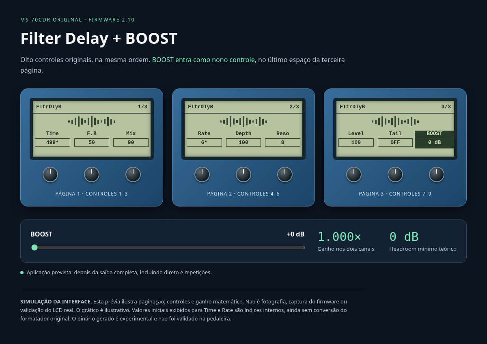

# FILTER DELAY BOOST — Zoom MS-70CDR original, firmware 2.10

**Candidato experimental gerado: `build/FLTRDLY_BOOST.ZDL`. Ainda não qualificado para instalar na pedaleira.**
O Filter Delay oficial foi extraído legitimamente. O novo adaptador preserva o corpo DSP original, os oito controles e acrescenta BOOST 0 a +12 dB. A estrutura e a execução foram testadas em computador/emulador; carregamento, CPU/RAM, presets e LCD no firmware real continuam pendentes. O ID `0xFFFE` é exclusivo dos testes desta entrega e não deve ser instalado.



[Prévia interativa da aparência](docs/filter-delay-boost/preview/index.html). É uma simulação, não uma captura da pedaleira.

- [Pesquisa e estrutura binária confirmada](docs/filter-delay-boost/RESEARCH.md)
- [Integração implementada e limites](docs/filter-delay-boost/INTEGRATION.md)
- [Testes e headroom](docs/filter-delay-boost/TESTS.md)
- [Relatório original reproduzível](docs/filter-delay-boost/original-analysis.json)

## Estrutura

`src/filter_delay_boost/`: primitiva C, adaptador TI e especificação do novo controle.
`tools/`: extrator somente leitura, inspetor ZDL/ELF e compilação da primitiva.
`original/`: instruções; binário oficial apenas local, sem redistribuição.
`build/`: objeto TI próprio, relatórios e candidato ZDL local ignorado pelo Git.
`docs/filter-delay-boost/`: evidências, resultados e próximos passos.

## Reproduzir

Requer Python 3 e compilador C host. Nenhuma dependência Python externa.

```sh
python tools/build_filter_delay_boost.py
python -m unittest discover -s tests -p 'test_filter_delay*.py' -v
```

Para análise do original, baixe o [ZIP oficial Zoom 2.10](https://zoomcorp.com/documents/93/MS-70CDR_v2.10_Win_E.zip), descompacte em uma pasta local e execute:

```sh
python tools/extract_filter_delay.py '/caminho/ZOOM MS-70CDR v2.10 Updater.exe'
python tools/inspect_zdl.py original/FLTRDLY.ZDL --output docs/filter-delay-boost/original-analysis.json
```

Os testes que dependem do original e do candidato são pulados quando esses binários locais estão ausentes. O relatório versionado registra a análise realmente executada com o original oficial.

Para compilar a primitiva TI após instalar o [CGT C6000 oficial](https://www.ti.com/tool/download/C6000-CGT):

```sh
python tools/build_filter_delay_boost.py --ti-root /caminho/ti-cgt-c6000_8.5.0.LTS
```

O `.obj` isolado não é um plugin. Para gerar o candidato experimental **localmente**:

```sh
python tools/integrate_filter_delay.py --ti-root /caminho/ti-cgt-c6000_8.5.0.LTS --experimental-fxid 0xfffe
python tools/inspect_zdl.py build/FLTRDLY_BOOST.ZDL --output build/modified-analysis.json
```

O script exige o hash do original conhecido. O arquivo resultante contém código proprietário Zoom, permanece fora do Git e não foi publicado na branch. Instruções do emulador: [tools/emulator](tools/emulator/README.md).

## Instalação, testes físicos e reversão

**Não instalar o candidato atual de ID experimental `0xFFFE`.** Há um arquivo real para análise/emulação, mas faltam auditoria de identidade, validação de inicialização no firmware e testes físicos. Não enviar um `.obj` à pedaleira nem renomeá-lo como `.ZDL`.

Quando houver um candidato validado, exportar e verificar backups de patches e da lista de efeitos antes de qualquer instalação manual. Manter o Filter Delay original; usar identidade e nome 8.3 exclusivos para a variante. Instalar manualmente um candidato por vez com ferramenta compatível com a MS-70CDR original, após validar tamanho, ID e estrutura. Nunca usar instruções de MS-70CDR+ ou ZD2 neste projeto.

Comparar gravações do original e da variante com BOOST=0, mesmas entradas/controles; depois medir cada passo até +12 dB, estéreo, bypass, Tail, presets salvos e carga de cadeia. Aumentar BOOST requer reduzir o nível anterior: +12 dB exige pelo menos 12 dB de headroom na saída original.

Para reverter uma variante futura: removê-la manualmente, restaurar os patches exportados e conferir o original. Se houver falha de inicialização, seguir a recuperação oficial Zoom e preservar os backups; não repetir gravações experimentais. Nenhuma gravação de efeitos ou firmware foi feita neste trabalho.

## Trabalho anterior

O phaser PhsDepth foi preservado em `src/phsdepth_dsp.*`, `zoom/` e `tests/test_phsdepth.c`; [documentação anterior](docs/PHSDEPTH_README.md). Ele também não é um ZDL pronto.
