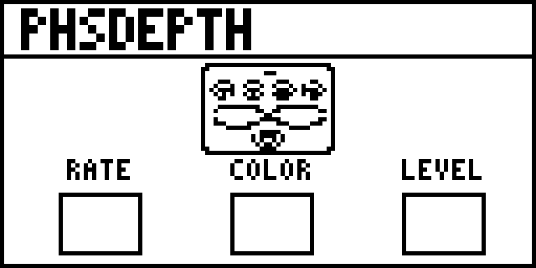

# PhsDepth — Zoom MS-70CDR original (azul), firmware 2.10

Candidato experimental compilado: **[dist/PhsDepth.ZDL](dist/PhsDepth.ZDL)**, 5.582 bytes. É um contêiner ZDL com código TI C674x, áudio ativo e quatro controles; **não foi instalado nem testado fisicamente na pedaleira**. A compatibilidade completa com o carregador, a interface e o áudio do firmware 2.10 ainda depende desse teste.

| Controle | Valores | Função |
|---|---|---|
| Rate | 0–100 | Velocidade do LFO triangular, 0,08–6 Hz; padrão 35 |
| Color | 0 / 1 / 2 / 3 | 4 normal / 8 normal / 4 invertido / 8 invertido |
| Level | 0–100 | Ganho de saída, 0–2×; 50 = ganho nominal unitário |
| Depth | 0–100 | Excursão logarítmica dos filtros em torno de 550 Hz, até ±3 oitavas |

Depth em zero mantém um phaser estático; não mistura seco/molhado. A soma é sempre 50% seco + 50% sinal dos filtros (polaridade definida por Color), multiplicada por Level. Os canais L/R têm memória independente. Rate, Color e Level ficam na primeira página; Depth na segunda. Color é mostrado numericamente.

Identidade: categoria Modulation (`gid 6`), `fxid 947`, índice **`0x060003B3`**. Não reutiliza o ID de um Phaser original. A [auditoria](docs/id-audit.json) de 11/11/2026 consultou 581 arquivos de sete coleções públicas, incluindo efeitos Zoom, manifests e bancos de IDs. Não encontrou esse fxid em nenhum grupo nas fontes consultadas. Não existe reserva global de IDs; a lista de efeitos realmente instalados também deve ser conferida.

## Imagem no pedal

Capa monocromática de 128×64 pixels, inspirada no Phaser da MS-70CDR+, adaptada à tela original. O preview abaixo está ampliado 6×, sem interpolação. As caixas vazias recebem os valores desenhados pelo firmware; Depth permanece na segunda página. A visualização física ainda não foi confirmada.



O sprite em `zoom/art/pedal.pbm` foi criado com geração de imagem a partir da referência fornecida e convertido para bitmap de um bit; `zoom/cover.py` compõe o título e a área dos controles. O build embute essa capa específica no ZDL.

## Validação concluída

- Compilação com **TI C6000 CGT 8.5.0.LTS**, C674x, EABI, dados `far`; sem símbolos DSP externos, heap, BSS ou globais graváveis no DSP.
- Linker de [repeat98/ZoomMultistompZDL](https://github.com/repeat98/ZoomMultistompZDL), fixado em `32f3d6877d892409c6defeeeec57040ad004d31f`. Runtime próprio (`own_runtime`) com handlers para os quatro controles e inicialização dos valores salvos; dispensa blobs extraídos de efeitos Zoom.
- Invariantes de áudio, limites dos buffers, bypass, instâncias independentes, controles inválidos, comparação host/wrapper, AddressSanitizer e UndefinedBehaviorSanitizer.
- Verificação independente de ZDL/ELF, arquitetura, exports, relocations, parâmetros, ID e tamanho; testes de rejeição de arquivos corrompidos.
- **Ziddle C674x**: 36 combinações, 655.360 amostras de canal comparadas ao DSP host; erro máximo **0,000000522**, nenhuma instrução não implementada. Inicialização e handlers também executados. [Relatório](dist/emulator-report.json).

O emulador usa callbacks de host simulados; não prova a ordem de inicialização do firmware, a paginação na tela, o roteamento estéreo real ou a ausência de travamentos na pedaleira. O custo DSP declarado (40) é uma estimativa provisória, sem medição física; ciclos do emulador não equivalem à carga real.

## Compilar e testar

Linux x86-64, Python 3.10+, compilador C, Git, curl e sha256sum:

```sh
./tools/build.sh                 # baixa TI oficial + referência fixada em work/
./tools/test.sh                  # testes C, sanitizers e artefato ZDL
python3 tools/validate_zdl.py
```

O instalador TI permanece local em `work/`; seus termos próprios se aplicam. Para usar instalações existentes:

```sh
python3 zoom/build.py --upstream /caminho/ZoomMultistompZDL \
    --ti-root /caminho/ti-cgt-c6000_8.5.0.LTS
```

Para repetir o teste do binário, extraia [Ziddle 1793487371](https://berbasoft.com/ziddle/ziddle-1793487371.zip), instale Rust/cargo e execute:

```sh
python3 tools/emulator/run.py --ziddle /caminho/ziddle-1793487371
```

Consulte [dependências e integração](docs/ZDL_INTEGRATION.md), [resultado dos testes](docs/VALIDATION.md) e [procedimento físico pendente](docs/INSTALLATION.md). Os hashes estão em [dist/SHA256SUMS](dist/SHA256SUMS). As licenças do runtime e os avisos TI acompanham o binário em [licenses/](licenses/).
